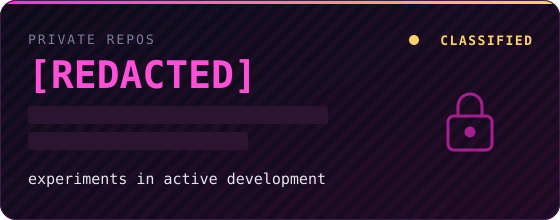
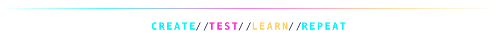

<a href="https://github.com/GAWI01">
  
</a>

<p align="center">
  <a href="https://www.linkedin.com/in/gabriel-witz%C3%B8e-51384a275"></a>
  <a href="https://github.com/GAWI01/FPL-AI"></a>
  
  
</p>

<br>

## `> whoami`

```python
class Gabriel:
    handle   = "GAWI01"
    location = "Norway 🇳🇴"
    role     = "Cybersecurity junior — building things"
    focus    = ["security engineering", "ai systems", "shipping real products"]
    loop     = ["create", "test", "learn", "repeat"]

    def status(self) -> str:
        return "probably building something"
```

## `> stack`

<p>
  
</p>

**Security tooling**

<p>
  
  
  
  
  
  
</p>

## `> ls ./projects`

<table>
  <tr>
    <td width="50%">
      <a href="https://github.com/GAWI01/FPL-AI"></a>
    </td>
    <td width="50%">
      
    </td>
  </tr>
</table>

## `> git log --stats`

<p align="center">
  
  
</p>

<p align="center">
  
</p>

<p align="center">
  <picture>
    <source media="(prefers-color-scheme: dark)" srcset="https://raw.githubusercontent.com/GAWI01/GAWI01/output/snake-dark.svg">
    <source media="(prefers-color-scheme: light)" srcset="https://raw.githubusercontent.com/GAWI01/GAWI01/output/snake-light.svg">
    
  </picture>
</p>


