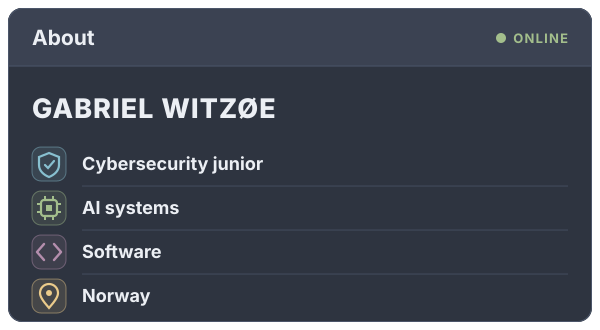
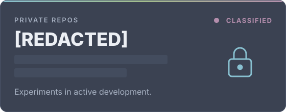

<table width="100%">
  <tr>
    <th width="50%" align="left">About</th>
    <th width="50%" align="left">Stack</th>
  </tr>
  <tr>
    <td></td>
    <td></td>
  </tr>
  <tr>
    <th align="left">Public</th>
    <th align="left">Private</th>
  </tr>
  <tr>
    <td></td>
    <td></td>
  </tr>
  <tr>
    <th align="left">GitHub stats</th>
    <th align="left">Languages</th>
  </tr>
  <tr>
    <td></td>
    <td></td>
  </tr>
  <tr>
    <td colspan="2" align="center"></td>
  </tr>
</table>

