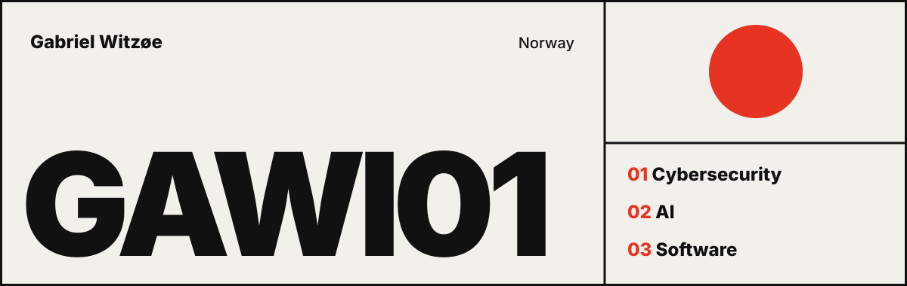
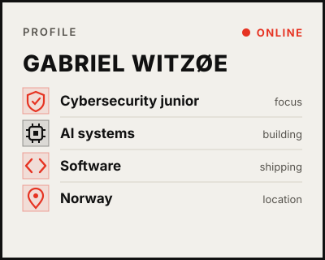
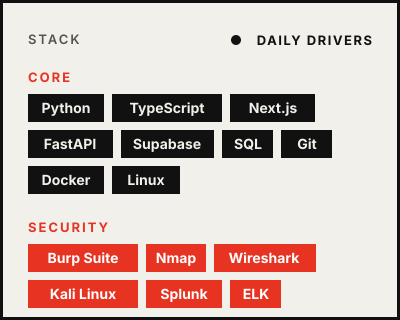
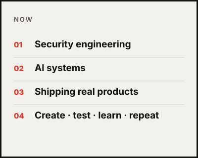
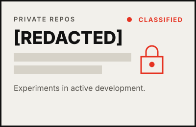

<table width="100%">
  <tr>
    <td width="33%" valign="top"></td>
    <td width="33%" valign="top"></td>
    <td width="33%" valign="top"></td>
  </tr>
</table>

<table width="100%">
  <tr>
    <td width="66%"></td>
    <td width="33%"></td>
  </tr>
</table>

<table width="100%">
  <tr>
    <td width="50%"></td>
    <td width="50%"></td>
  </tr>
</table>

